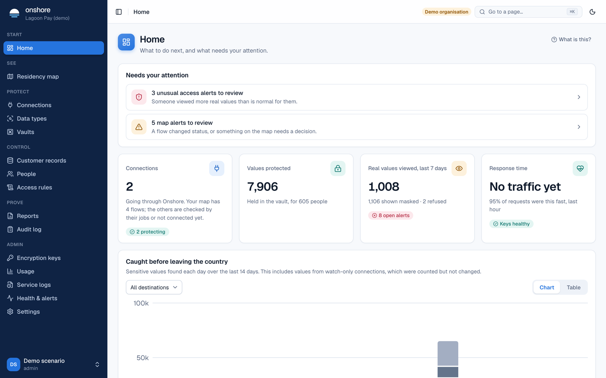
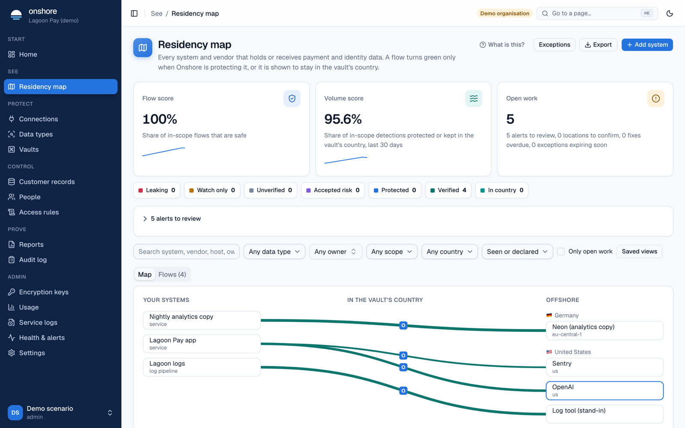
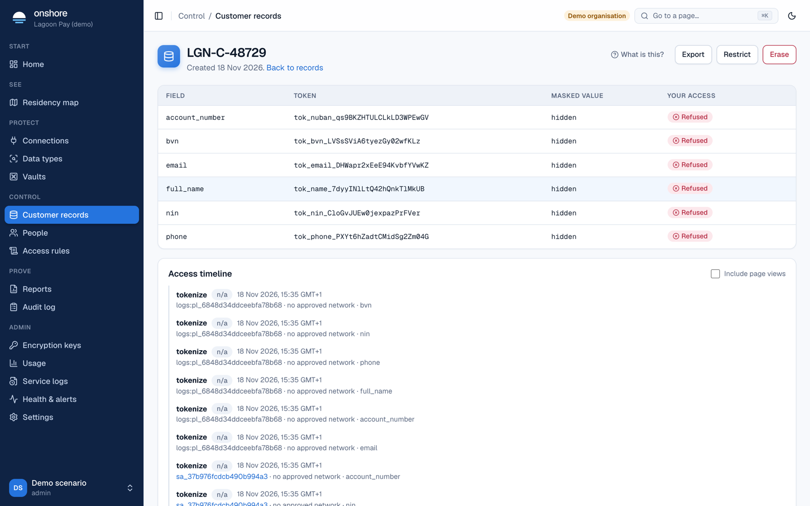
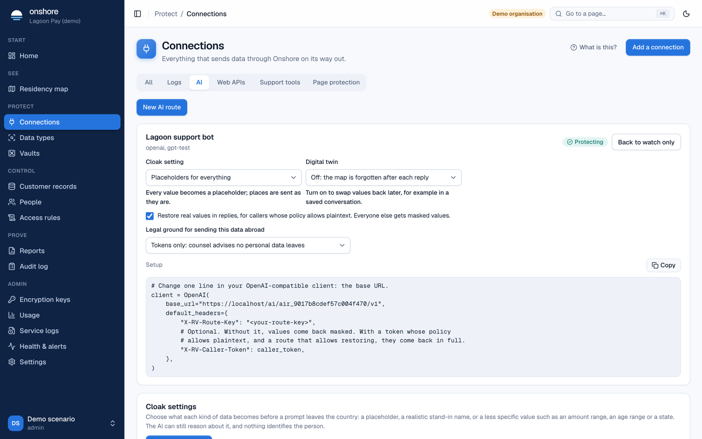

<div align="center">


### Keep customer data in its country. Keep your global tools.

[](LICENSE)
[](ee/LICENSE)
[](https://www.npmjs.com/package/@onshorehq/sdk)
[](https://docs.onshorevault.com)

[Website](https://www.onshorevault.com) · [Documentation](https://docs.onshorevault.com) · [API reference](https://docs.onshorevault.com/api-reference/) · [SDKs](https://docs.onshorevault.com/developers/sdks/) · [Editions](https://docs.onshorevault.com/get-started/editions/)

</div>

**Onshore is an open-core data residency vault.** It swaps national IDs, bank accounts, phone numbers, names and amounts for tokens or placeholders before they leave a country. Your apps, logs, AI tools and vendors keep working with tokens, and the real values stay in a vault in the country they belong to, behind access rules and a tamper-evident audit log.

When you're breached, attackers get tokens instead of your customers' identities, and you can prove exactly what was touched.

**Use AI without handing it your customers' data.** Point your OpenAI or Anthropic client at Onshore's AI gateway with a one-line change. Before a prompt leaves the country, the gateway swaps names, ID numbers, phone numbers, account details and other personal data for placeholders or realistic stand-in names, so the model works on the task without ever seeing who it's about. Replies come back with the real values restored, but only for people whose access rules allow it.

<p align="center">
  
</p>

## What Onshore does

**Core**
- **Vault.** Each value is encrypted on its own; keys live in a separate key service (3 of 5 key holders to unseal) or your own HSM. Your systems store tokens.
- **Detection.** Finds sensitive values in text, logs and files, with country packs for the US, UK, EU, Canada, Brazil, India, Singapore, the Gulf and Africa, and data types of your own.
- **Access rules.** Default deny. Who may see what, plaintext or masked, for which purpose, from which network, at what time, up to how many an hour.
- **Audit and evidence.** A hash-chained audit log with signed checkpoints, and signed reports for regulators.

**Stop the leaks**
- **Log pipelines** tokenize identifiers before logs reach outside tools.
- **AI gateway and cloaking** send prompts to any model without identifiers, and restore the replies for people allowed to see them.
- **HTTP proxy** tokenizes values in calls to outside vendors, in JSON, forms, XML and files.
- **Support tool adapters** and **file redaction** clean tickets and documents.

**Collect and prove**
- **Secure components** collect and show values in a frame served by the vault (web, iOS, Android, React Native), so your servers never see them.
- **Residency map** shows every system and vendor that holds or receives data, and whether each flow is protected.
- **Data subject requests:** find a person, export, restrict and erase.

**Run it your way**
- Self-host one install per country, link installs across countries under one console, or use Onshore Cloud.
- Sign in with authenticator codes or passkeys; single sign-on (SAML, OIDC), SCIM and LDAP.

<table>
  <tr>
    <td width="50%"><br><sub><b>Residency map.</b> Every flow from your systems to vendors abroad, and whether Onshore protects it.</sub></td>
    <td width="50%"><br><sub><b>A customer record.</b> Only tokens, reveals decided by access rules, and every access on the timeline.</sub></td>
  </tr>
  <tr>
    <td colspan="2"><br><sub><b>AI gateway.</b> Point your OpenAI or Anthropic client at Onshore with one line; identifiers are cloaked before the prompt leaves the country.</sub></td>
  </tr>
</table>

## Quick start

**See what's in your logs**, offline, without changing anything:

```sh
cd data-plane && go run ./cmd/rv scan /path/to/app.log
```

**Run the full stack** with Docker Compose:

```sh
cd deploy/compose
docker compose --profile logs --profile ai --profile proxy --profile adapters --profile files --profile tools build
./rv init --host vault.example.com --country gb   # writes .env and prints the bootstrap token; the country is final
docker compose up -d keys postgres
./rv keys init                                     # 5 key shares, any 3 unseal; shown once
docker compose --profile logs --profile ai --profile proxy up -d
./rv doctor                                        # pass/fail report for your change ticket
```

Open `https://<host>/`, run first-time setup with the bootstrap token, and follow the [setup guide](https://docs.onshorevault.com/get-started/).

**Logs and monitoring** (optional): `docker compose --profile observability up -d` adds Grafana Loki, Grafana Alloy, Prometheus and Grafana, with a ready-made dashboard at `https://<host>/grafana/`. See [Logs and monitoring](https://docs.onshorevault.com/operate/observability/).

<details>
<summary>More install options: your own certificate, linked installs, Onshore Cloud</summary>

- **Your own certificate:** put it in `certs/` and set `RV_TLS=/certs/cert.pem /certs/key.pem` in `.env`.
- **Host hardening:** disable or encrypt swap. After a restart the key service is sealed until key holders run `./rv keys unseal`.
- **An install in another country (Enterprise),** linked to your main console. Get the join code in **Settings → Locations and laws**:
  ```sh
  ./rv init --host vault.de.example.com --country de --join rvj_… --primary https://onshore.example.com
  ```
  A linked install joins its primary within a minute and needs outbound HTTPS to it; the primary never connects in. With a private CA, set `RV_PRIMARY_CA=/certs/primary-ca.pem`.
- **Onshore Cloud** deployments set `RV_CLOUD=1` and `RV_CLOUD_REGIONS` (for example `GB,DE,NG`).

</details>

**Store a value from your code:**

```ts
import { VaultClient } from "@onshorehq/sdk";

const vault = new VaultClient({ baseUrl, serviceAccountId, keyId, privateKey });
const [{ token }] = await vault.tokenize("v_live_…", [{ field: "national_id", value: "AB123456C" }]);
// Save `token` in your database instead of the value.
```

## SDKs

| Server | Install | Client | Install |
| --- | --- | --- | --- |
| [Node.js](https://github.com/Onshore-HQ/onshore-node) | `npm install @onshorehq/sdk` | [Web](https://docs.onshorevault.com/developers/sdks/web/) | `rv.js`, served by your vault |
| [Python](https://github.com/Onshore-HQ/onshore-python) | `pip install "onshore @ git+https://github.com/Onshore-HQ/onshore-python@v0.1.0"` | [iOS](https://github.com/Onshore-HQ/onshore-ios) | Swift Package Manager |
| [Go](https://github.com/Onshore-HQ/onshore-go) | `go get github.com/Onshore-HQ/onshore-go@v0.1.0` | [Android](https://github.com/Onshore-HQ/onshore-android) | Build the AAR |
| [Java](https://github.com/Onshore-HQ/onshore-java) | `mvn install` from the repository | [React Native](https://github.com/Onshore-HQ/onshore-react-native) | `npm install @onshorehq/react-native` |
| [PHP](https://github.com/Onshore-HQ/onshore-php) | Composer, from the repository | | |

Every SDK is Apache-2.0. Full references: [docs.onshorevault.com/developers/sdks](https://docs.onshorevault.com/developers/sdks/).

## Editions

| | Community | Business | Enterprise | Onshore Cloud |
| --- | --- | --- | --- | --- |
| Licence | AGPL-3.0, free | Commercial | Commercial | Coming soon |
| What you get | The core vault, detection, basic access rules, audit, SDKs | Everything for production in one country: AI, logs, proxy, secure components, residency map, data subject tools, advanced rules, reports, SSO and SCIM | Several countries under one console, LDAP, SIEM streaming, HSM, 24/7 support | We run it, in each country we open |

Paid features are free for development, testing and on test vaults. See [Editions](https://docs.onshorevault.com/get-started/editions/).

## Repository layout

| Path | What it is |
| --- | --- |
| `data-plane/` | Go: vault API, detection, policy engine (CEL), audit chain, `rv` CLI, SQL migrations. Paid services in `data-plane/ee/` |
| `control-api/` | TypeScript, Fastify and Prisma: organisations, rules, people, connections, reports. Its database role can't read the `data` schema. Paid routes in `control-api/src/ee/` |
| `console/` | Next.js admin console |
| `deploy/` | Dockerfiles, Compose, Helm, Caddy, OpenBao config |
| `docs-site/` | The documentation site (Nextra), with a Scalar API reference |
| `docs/` | OpenAPI files, design notes, known gaps, test reports |
| `demo/` | Lagoon Pay, a fictional fintech, and the scenario engine for demos |
| `scripts/` | End-to-end, integration, SDK, HSM and penetration test scripts |

SDKs live in their own repositories under [Onshore-HQ](https://github.com/Onshore-HQ); `scripts/test-sdks.sh` expects them cloned into `sdks/`. The website is in [Onshore-HQ/website](https://github.com/Onshore-HQ/website).

The Prisma schema is generated from a migrated database. SQL in `data-plane/migrations` is the source of truth; after changing it, run `npx prisma db pull && npx prisma generate` in `control-api` with `PRISMA_DATABASE_URL` set.

## Development and tests

```sh
cd data-plane && go test ./...          # unit tests, including detection quality targets
scripts/test-integration.sh             # data API against real PostgreSQL
scripts/test-hsm.sh                     # the PKCS#11 backend against SoftHSM
(cd control-api && npm test)            # control API unit tests
scripts/e2e.sh                          # customer-style install, then every SDK (memory-hungry; destroys this project's Compose containers first)
scripts/pentest.mjs                     # attacks a local install; see docs/pentest-report.md
scripts/console-smoke.mjs               # the console and CSP in a real browser; needs Playwright outside the repo
```

`e2e.sh` covers tenant boundaries, default deny, the two-person rule, fail-closed behaviour with the vault down and the key service sealed, key rotation, tamper detection on a live database, and a sweep of a full `pg_dump` and every service log for the plaintext it stored.

<details>
<summary>Measured performance and detection quality</summary>

On a 2019 Intel MacBook with everything in Docker Desktop, through the TLS edge. Treat these as a rough floor, not server numbers. Method and caveats: [`docs/performance.md`](docs/performance.md).

| Measure | Target | Measured p95 | Throughput | Result |
| --- | --- | --- | --- | --- |
| Tokenize, batch of 10, one client | under 30 ms | 18 to 20 ms | about 70 batches/s | Met |
| Detokenize, batch of 10, one client | under 30 ms | 7 to 8 ms | about 160 batches/s | Met |
| Tokenize, batch of 10, 10 concurrent | under 30 ms | 37 to 43 ms | 300 to 335 batches/s | **Not met**, close |
| Detokenize, batch of 10, 10 concurrent | under 30 ms | 22 to 33 ms | 525 to 620 batches/s | Borderline |
| Log processor, full path through the edge | 20,000 lines/s per 2 cores | n/a | about 29,000 lines/s, not limited to 2 cores | **Unproven** |
| Detection, 1 KB on one core | under 1 ms | 0.61 ms | | Met |

**The Node SDK is held back on Node 26:** its global `fetch` sends one request at a time, capping one process at about 150 detokenize batches/s. Pass an undici-based client through the SDK's `fetch` option for now.

**Detection quality:** on the synthetic corpus, every entity type meets its target, at 100% after tuning. That proves little, since the same author wrote the rules and the corpus. An untuned held-out set of awkward real-world shapes (`data-plane/internal/detect/heldout_test.go`) scores 20/22. Real log samples from design partners are the real test.

</details>

<details>
<summary>Design notes in this repository</summary>

| Note | Covers |
| --- | --- |
| [`docs/residency-map.md`](docs/residency-map.md) | How the residency map works out each flow's status from evidence |
| [`docs/custom-entities.md`](docs/custom-entities.md) | Your own sensitive data types |
| [`docs/secure-components.md`](docs/secure-components.md) | Embeddable collect and reveal frames |
| [`docs/mobile-sdks.md`](docs/mobile-sdks.md) | iOS, Android and React Native, and what has run on each |
| [`docs/webhooks-monitoring.md`](docs/webhooks-monitoring.md) | Signed events, service health, and metrics for Grafana or Datadog |
| [`docs/page-protection.md`](docs/page-protection.md) | Script inventory, approval and change alerts on sensitive pages |
| [`docs/proxy-formats.md`](docs/proxy-formats.md) | Forms, XML and SOAP, multipart, files and headers through the HTTP proxy |
| [`docs/identifier-rules.md`](docs/identifier-rules.md), [`docs/regulatory-notes.md`](docs/regulatory-notes.md) | Identifier formats and the laws behind them |

</details>

## Contributing

Contributions are welcome. Read [CONTRIBUTING.md](CONTRIBUTING.md) first: every contributor signs the [Contributor Licence Agreement](CLA.md) once, through a check on the pull request.

**Found a security issue?** Report it privately through this repository's **Security** tab, or email security@onshorevault.com. Please don't open a public issue.

## Licence

Onshore is open core. Copyright © 2026 Flowsplus Services.

- **Core:** [GNU AGPL-3.0](LICENSE). Free to use, change and self-host. If you offer a changed version to others as a service, you must publish your changes.
- **Paid features**, in every directory named `ee` (`data-plane/ee`, `control-api/src/ee`): [Onshore Commercial Licence](ee/LICENSE). Free for development, testing and test vaults; production needs a subscription. See [ee/README.md](ee/README.md).
- **Documentation** in `docs-site/content/`: [CC BY 4.0](docs-site/CONTENT-LICENSE).
- **SDKs:** Apache-2.0, in their own repositories.

Can't use AGPL? Business and Enterprise subscriptions include the core under the commercial licence. See [NOTICE](NOTICE), [TRADEMARKS.md](TRADEMARKS.md) and [CONTRIBUTING.md](CONTRIBUTING.md).
